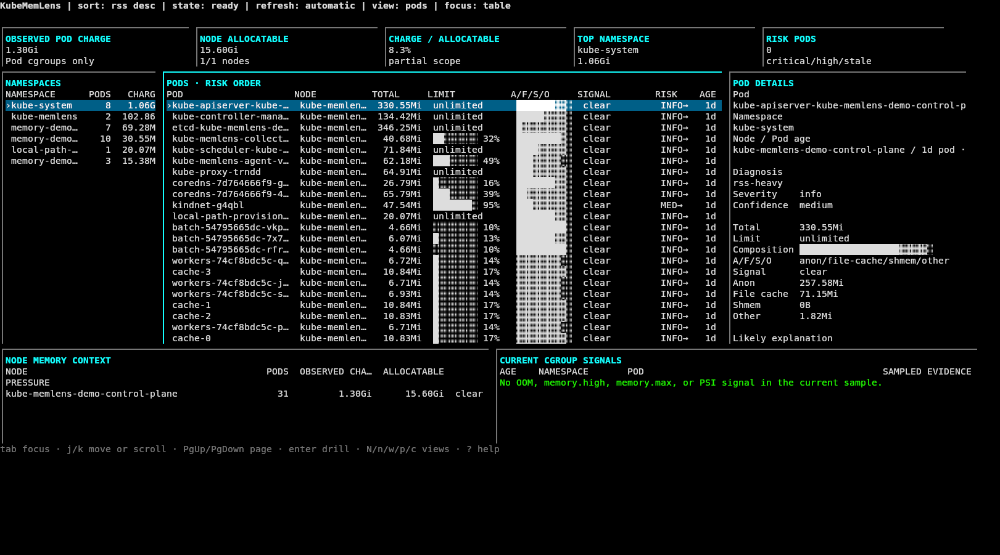

# KubeMemLens

**See why a Kubernetes Pod's memory is high before it is OOMKilled.**

`kubectl top` shows working set, which counts active page cache as well as
application memory, so a Pod can look close to its limit while much of that
memory is reclaimable cache. KubeMemLens reads cgroup v2 memory statistics on
each node and splits Pod and container memory into anonymous memory, file
cache, tmpfs/shared memory and other, so you can tell a real leak from cache.

[](https://github.com/danushkastanley/KubeMemLens/actions/workflows/ci.yml)
[](https://github.com/danushkastanley/KubeMemLens/releases/latest)
[](LICENSE)
[](https://scorecard.dev/viewer/?uri=github.com/danushkastanley/KubeMemLens)
[](https://www.bestpractices.dev/en/projects/14259)

[Website](https://kubememlens.com) · [Installation](docs/installation.md) ·
[Support and compatibility](docs/compatibility.md) · [Changelog](CHANGELOG.md)

<!-- Demo GIF placeholder: replace with a recording of a cache-heavy Pod
     after v1.0.3, for example docs/images/demo.gif. -->

- **Never changes your workloads.** It reads cgroup files and Kubernetes
  metadata; recommendations are printed for you to review, never applied.
- **Built for incidents.** A terminal dashboard, per-Pod explanations with
  severity, confidence and caveats, and redacted incident capture with offline
  replay.
- **No telemetry.** Nothing leaves your cluster or terminal.

## Quick start

1. Install the CLI on macOS or Linux (Windows archives are on the
   [release page](https://github.com/danushkastanley/KubeMemLens/releases/tag/v1.0.3)):

   ```sh
   VERSION=1.0.3
   OS=$(uname -s | tr '[:upper:]' '[:lower:]')
   ARCH=$(uname -m | sed -e 's/x86_64/amd64/' -e 's/aarch64/arm64/')
   curl -fsSLO "https://github.com/danushkastanley/KubeMemLens/releases/download/v${VERSION}/kube-memlens_${VERSION}_${OS}_${ARCH}.tar.gz"
   tar -xzf "kube-memlens_${VERSION}_${OS}_${ARCH}.tar.gz" kubectl-memlens
   sudo install -m 0755 kubectl-memlens /usr/local/bin/kubectl-memlens
   kubectl memlens version
   ```

   [Verify the download](#verify-a-download) before installing it on a shared
   machine. A Krew package is not published yet. `go install` is not supported
   because the Go module path differs from the repository name; use a release
   archive or [build from source](docs/installation.md#build-the-cli-from-source).

2. Install the in-cluster components (needs permission to install a chart with
   cluster-scoped RBAC):

   ```sh
   helm upgrade --install kube-memlens \
     oci://ghcr.io/danushkastanley/charts/kube-memlens \
     --version 1.0.3 \
     --namespace kube-memlens \
     --create-namespace
   ```

3. Check the install and open the dashboard:

   ```sh
   kubectl memlens doctor
   kubectl memlens tui
   ```

   Readers who are not cluster administrators need a RoleBinding first; see
   [what it installs and what it can access](#what-it-installs-and-what-it-can-access).

To try the explanations without a cluster, run the samples built into the CLI:

```sh
kubectl memlens sample list
kubectl memlens sample explain cache-heavy
```

v1.0.2 and earlier need a source checkout with Go 1.27 for this:
`go run ./cmd/kubectl-memlens sample explain cache-heavy`.

## How it compares

KubeMemLens complements a metrics stack; it does not replace one.

| | `kubectl top` | k9s | Prometheus and Grafana | KubeMemLens |
| --- | --- | --- | --- | --- |
| Memory figure | Working set from the Metrics API | Working set from the Metrics API | Whatever you chart from cAdvisor, such as working set, RSS and cache | cgroup v2 charge split into anon, file cache, tmpfs and other |
| Explains the likely cause | No | No | Only if you build it | Yes, with severity, confidence and caveats |
| History | None | None | As long as you retain it | 15 minutes in collector memory by default |
| Needs in the cluster | metrics-server | metrics-server | Prometheus, exporters and dashboards | The KubeMemLens chart: a DaemonSet and one collector |
| Offline incident record | No | No | Dashboard snapshots | Redacted capture, replay and comparison |
| Scope | One number per Pod or container | General cluster browser | General observability | Memory incidents only |

An optional read-only [K9s plugin](docs/k9s-integration.md) opens the selected
Pod's explanation from k9s, and the chart can export
[Prometheus metrics](docs/metrics.md) with the same composition.

## How it measures

**Deep mode (with the chart).** An agent on each Linux node reads every
container's cgroup v2 files (`memory.current`, `memory.stat`, `memory.events`
and `memory.pressure`) every five seconds through a read-only mount of
`/sys/fs/cgroup`. It sends snapshots to one in-memory collector, which you
query through the Kubernetes API server with your own RBAC. metrics-server is
not needed.

**Restricted mode (no chart).** The CLI reads working set from the Kubernetes
Metrics API, which needs metrics-server. It cannot split memory into the
buckets below. See [restricted mode](docs/restricted-mode.md).

| Term | cgroup v2 source | Meaning |
| --- | --- | --- |
| Working set | `memory.current` minus `inactive_file` | What `kubectl top` shows and what the kubelet uses for eviction under node memory pressure. It includes active page cache. |
| Anonymous memory (anon) | `anon` in `memory.stat` | Heap, stacks and other memory not backed by a file. This is usually the figure that tracks application growth or a leak. It is not the same as process RSS, which also counts mapped file pages and shared memory. |
| File cache | `file` minus `shmem` | Page cache for files the container has read or written. The kernel reclaims it under memory pressure, so a high value alone rarely causes an OOM kill. |
| Tmpfs and shared memory | `shmem` | tmpfs, memory-backed `emptyDir` volumes and shared memory. It counts towards the limit and cannot be reclaimed while the files exist unless swap is enabled. |
| Other | `memory.current` minus `anon` and `file` | Kernel memory charged to the cgroup, such as slab, page tables and socket buffers. |

A container is OOM-killed when its usage reaches `memory.max` and the kernel
cannot reclaim enough. File cache is reclaimed first, so growth in anonymous
memory or tmpfs is the usual risk. From v1.0.3 the CLI and TUI label this
bucket "Anonymous (anon)" and `ANON`; v1.0.2 and earlier label it "RSS / anon".
The `rss-heavy` diagnosis keeps its name for compatibility, and from v1.0.3 it
needs anonymous memory to be at least half of a finite limit, or 512 MiB
without one. The full model, including the
overlapping kernel and writeback detail, is in
[memory semantics](docs/memory-semantics.md).

## Resource overhead

| Component | Chart default requests | Chart default limits |
| --- | --- | --- |
| Agent, one per Linux node | 10m CPU, 96 MiB | 128 MiB |
| Collector, one replica | 10m CPU, 192 MiB | 256 MiB |

Measured results:

- **5,000 containers on four-node kind for 30 minutes:** agent p95 about
  63 MiB, collector p95 about 160 MiB, 0% CPU throttling, CLI p95 464 ms. See
  the [recorded result](docs/qualification-results/rc-5000-local-kind-2026-08-26.md).
- **Idle single-node kind with v1.0.2:** about 12 MiB for the agent and 16 MiB
  for the collector, as charged by their own cgroups.

These are local measurements, not managed-provider sizing claims. Tune the
limits from your own cluster density using the
[installation guide](docs/installation.md#upgrade).

## What it installs and what it can access

KubeMemLens never creates, changes or deletes your workloads. The chart does
install cluster components, and these are their permissions:

| Component | Kubernetes permissions | Host access and runtime |
| --- | --- | --- |
| Agent (DaemonSet on Linux nodes) | `get`, `list`, `watch` Pods; `get` Nodes (it reads only its own); `get` ReplicaSets and Jobs to find the owning workload; `create` node snapshots and `get` ingestion epochs in the KubeMemLens API | Read-only hostPath mount of `/sys/fs/cgroup`. Runs as UID 65532, not privileged, all capabilities dropped, read-only root filesystem. |
| Collector (Deployment, one replica) | `list` Nodes; `system:auth-delegator` to check each reader's permissions; read the `extension-apiserver-authentication` ConfigMap in `kube-system` | No host access. Same restricted security context. |
| Certificate bootstrap (Helm hook Job) | `get` and `update` only the `v1alpha1.memory.kubememlens.io` APIService and the `kube-memlens-extension-tls` Secret | No host access. Same restricted security context. |
| APIService | Registers `memory.kubememlens.io/v1alpha1`, so every read and agent write goes through the Kubernetes API server | Not applicable |

The chart also creates NetworkPolicies and three reader ClusterRoles, which it
never binds: `kube-memlens-namespace-viewer`, `kube-memlens-cluster-viewer` and
`kube-memlens-metrics-reader`. To let one user read one namespace:

```sh
kubectl create rolebinding kube-memlens-namespace-viewer \
  --namespace <namespace> \
  --clusterrole kube-memlens-namespace-viewer \
  --user <user>
```

The [tenant-scoped read runbook](docs/runbooks/tenant-scoped-reads.md) covers
cluster-wide grants, revocation and verification.

## Supported environments

- **Kubernetes:** 1.35, 1.36 and 1.37, covered by kind lifecycle tests in CI.
- **Provider support:** AWS EKS managed Linux nodes with AL2023, containerd and
  amd64. Other providers and self-managed clusters may work but are outside the
  current support scope.
- **Nodes:** Linux with cgroup v2 and an enforcing NetworkPolicy CNI.
  cgroup v1, Windows nodes, GKE Autopilot, EKS Fargate and AKS are unsupported
  for deep mode.
- **CLI:** macOS 13 or later, Linux and Windows on amd64 and arm64.

The [support and compatibility contract](docs/compatibility.md) is the
canonical source, including historical provider results and unsupported
profiles.
The legacy `v0.0.1-alpha.3` release is not suitable for shared multi-tenant clusters.

## Verify a download

Release archives, the image and the chart are signed with Sigstore keyless
signing and carry GitHub build provenance. With the
[GitHub CLI](https://cli.github.com/):

```sh
gh release verify "v${VERSION}" --repo danushkastanley/KubeMemLens
gh attestation verify "kube-memlens_${VERSION}_${OS}_${ARCH}.tar.gz" \
  --repo danushkastanley/KubeMemLens
```

With [cosign](https://docs.sigstore.dev/cosign/system_config/installation/),
download `checksums.txt` and `checksums.txt.sigstore.json` from the same
release. A stable release reuses the exact bytes of its release candidate, so
the candidate workflow signs this file:

```sh
cosign verify-blob checksums.txt \
  --bundle checksums.txt.sigstore.json \
  --certificate-oidc-issuer https://token.actions.githubusercontent.com \
  --certificate-identity-regexp '^https://github\.com/danushkastanley/KubeMemLens/\.github/workflows/candidate\.yml@refs/tags/v[0-9]+\.[0-9]+\.[0-9]+-rc\.[0-9]+$'
shasum -a 256 --ignore-missing -c checksums.txt
```

`promotion-checksums.txt` is signed by `promote.yml` at the stable tag and
covers `checksums.txt`. To verify the image, take its digest from
`promotion-subjects.txt` and run
`gh attestation verify oci://ghcr.io/danushkastanley/kube-memlens@<digest> --repo danushkastanley/KubeMemLens`.

### Release candidate artefacts

The proposed `v1.0.3-rc.1` candidate uses
`oci://ghcr.io/danushkastanley/candidates/1.0.3-rc.1/charts/kube-memlens`
with `--version 1.0.3` and image repository
`ghcr.io/danushkastanley/candidates/1.0.3-rc.1/kube-memlens`.
Candidate installs override the image repository and pin the image digest from
its signed `candidate-manifest.json`. Stable promotion preserves those exact
archive, image and chart bytes.

## TUI 2.0



The terminal interface is an incident-focused memory cockpit rather than a generic Kubernetes browser. Its current workflow includes:

- responsive compact, standard and wide layouts, with a usable 80×24 minimum and a master-detail dashboard from 150×30;
- virtualised tables and detail views with stable selection across refresh, sorting and filtering;
- first-class node, namespace, workload, Pod and container navigation;
- risk-oriented Pod ordering plus structured severity, diagnosis, pressure, owner and freshness filters;
- non-overlapping anonymous/file-cache/shmem/other composition bars, limit/headroom gauges, live trends and sampled OOM, `memory.high`, `memory.max` and PSI signals;
- bounded, race-safe selected-Pod history that retains the last good series through a refresh error;
- read-only recommendations, live Pod comparison, safe command copy and mode-`0600` redacted incident capture; and
- Kubernetes aggregated-API connectivity by default, with no port-forward required for normal use.

Select a Pod and press **Enter** for the [Pod dashboard](docs/pod-dashboard.md).
Press **Esc** to return with the previous selection and filter preserved.

The summary deliberately says **observed Pod charge**: it is the sum of mapped Pod cgroups, not total cluster or node memory usage. Colours reinforce text labels but are not required; set `NO_COLOR=1` for monochrome output.

The one-time [terminal qualification record](docs/qualification-results/terminal-runtime-e631f20/README.md) covers the exact xterm, Kitty, Alacritty, tmux and delayed SSH rows it exercised. Apple Terminal and Ghostty were installed but could not be driven through the host automation boundary; iTerm2 and Warp were absent. Those macOS emulators remain unqualified rather than inferred from a pseudo-terminal.

## Example

```sh
go run ./cmd/kubectl-memlens sample explain cache-heavy
```

```text
Sample: cache-heavy

Total charged memory: 4.10 GiB
Anonymous (anon):     1.20 GiB
File cache:           2.51 GiB
Shmem / tmpfs:        90.00 MiB
Residual / other:     307.20 MiB

Secondary detail (overlaps primary composition):
Active file:          2.20 GiB
Inactive file:        380.00 MiB
Kernel total:         180.00 MiB
Slab:                 140.00 MiB
  reclaimable:        100.00 MiB
  unreclaimable:      40.00 MiB
Socket memory:        2.00 MiB
Page tables:          8.00 MiB
Mapped file:          50.00 MiB
THP anon/file/shmem:  0 B / 0 B / 0 B
Other kernel:         40.00 MiB
Dirty/writeback:      low

Diagnosis:
cache-heavy
Severity: info
Confidence: medium — The composition is measured directly, while the likely cause remains a single-snapshot heuristic.
```

```sh
go run ./cmd/kubectl-memlens sample top
go run ./cmd/kubectl-memlens version
```

## Development

```sh
go test ./...
go run ./cmd/kubectl-memlens sample list
go run ./cmd/kubectl-memlens sample explain cache-heavy
go run ./cmd/kubectl-memlens sample top
```

Make targets are available:

```sh
make test
make coverage
make build
make run-sample-top
make run-sample-explain
make fmt
make vet
make vuln
make check
make verify-scale-capacity # deterministic capacity and degraded-state tests
make soak-live-density # requires the explicit profile and acknowledgement in docs/scale-qualification.md
make qualify-cluster # requires the explicit environment in docs/qualification.md
```

Use the [scale qualification guide](docs/scale-qualification.md) for the development smoke, RC profile, evidence contract and claim limits. Ordinary development does not require the 5,000-container run.

## Community and support

KubeMemLens is community maintained on a best-effort basis. Read
[SUPPORT.md](SUPPORT.md) for public installation and usage help,
[CONTRIBUTING.md](CONTRIBUTING.md) before proposing a change, and
[SECURITY.md](SECURITY.md) for private vulnerability reporting. The
[installation feedback form](https://github.com/danushkastanley/KubeMemLens/issues/new?template=adopter_feedback.yml)
records only a version, minimal environment profile, and outcome; it is not
telemetry and does not create a provider-support claim.

## Cluster Smoke Test

Start minikube with Docker:

```sh
minikube start --driver=docker --cpus=2 --memory=4096
```

Build and load a local image:

```sh
docker build -t kube-memlens:local-smoke .
minikube image load kube-memlens:local-smoke
```

Deploy the chart:

```sh
helm upgrade --install kube-memlens ./charts/kube-memlens \
  -n kube-memlens \
  --create-namespace \
  --set image.repository=kube-memlens \
  --set image.tag=local-smoke \
  --set image.pullPolicy=Never
```

When iterating quickly, use a fresh image tag or restart the workloads after `minikube image load` so the cluster does not keep an older local image.

Inspect the workloads:

```sh
kubectl get all -n kube-memlens
kubectl logs -n kube-memlens ds/kube-memlens-agent
kubectl logs -n kube-memlens deploy/kube-memlens-collector
```

Run a one-shot agent scan:

```sh
kubectl exec -n kube-memlens ds/kube-memlens-agent -- /memlens-agent --cgroup-root=/host/sys/fs/cgroup --once
```

Inspect the authenticated API through Kubernetes:

```sh
kubectl get --raw /apis/memory.kubememlens.io/v1alpha1
kubectl get --raw /apis/memory.kubememlens.io/v1alpha1/namespaces/<namespace>/pods
kubectl get --raw /apis/memory.kubememlens.io/v1alpha1/namespaces/<namespace>/pods/<pod-name>/history
kubectl get --raw /apis/memory.kubememlens.io/v1alpha1/clusterstatus/current
```

Use the CLI against collector snapshots without a manual port-forward:

```sh
go run ./cmd/kubectl-memlens status
go run ./cmd/kubectl-memlens doctor
go run ./cmd/kubectl-memlens top pods -A
go run ./cmd/kubectl-memlens top containers -A
go run ./cmd/kubectl-memlens top workloads -A
go run ./cmd/kubectl-memlens top ns
go run ./cmd/kubectl-memlens explain pod <pod-name> -n <namespace>
go run ./cmd/kubectl-memlens explain workload deployment/<name> -n <namespace>
go run ./cmd/kubectl-memlens history pod <pod-name> -n <namespace>
go run ./cmd/kubectl-memlens --mode=deep capture -n <namespace> --pod <pod-name> --include-history -o incident.json
go run ./cmd/kubectl-memlens replay incident.json --pod <namespace>/<pod-name>
go run ./cmd/kubectl-memlens compare pod/<first> pod/<second> -n <namespace>
go run ./cmd/kubectl-memlens compare --before before.json --after after.json --pod <namespace>/<pod-name>
go run ./cmd/kubectl-memlens compare --before before.json --after after.json --workload <namespace>/<kind>/<name>
```

`top pods`, `top containers`, and `top workloads` accept Kubernetes Pod label selectors with `-l`, safe field selectors, `--sort-by`, `--no-headers`, and `-o table|json|yaml|csv`. Add `--watch` for a two-second terminal refresh, or set a bounded interval with `--watch-interval`.

Deep Pod comparisons across captures calculate rates from source sample times only when the Pod UID and selection match, both sample times are known and increasing, and neither observation is stale. Redacted captures omit Pod UIDs, so their values are shown without rates. Workload capture comparisons also omit rates because their totals can span different Pod instances and sample times.

Restricted mode also supports [private capture, offline replay and working-set comparison](docs/restricted-incidents.md), with schema 3 and explicit partial-evidence caveats.

Development builds include optional [memory trends](docs/memory-history.md) from
an operator-owned, identity-enriched Prometheus service. Use `history trends` or
press `H` in the TUI to choose remote working set/RSS or explicit local history.
The feature is disabled by default and has passed local installation, reader
isolation and rollback checks. It does not change existing history retention or
install Prometheus; managed-provider qualification remains separate.
Opt-in [workload change markers](docs/memory-change-markers.md) add bounded
rollout, restart and resize context, with redacted capture and offline comparison.
Development builds also offer opt-in [incident sessions](docs/incident-sessions.md)
for bounded, owner-scoped records of evidence and decisions. Sessions remain in
collector memory; export required records before an upgrade or restart. Deployed
qualification remains separate. Trace references keep report bytes local and
identify their source as operator-supplied.

Optional [replica comparisons](docs/replica-baselines.md) use current local cgroup
evidence and bounded history. Use `replicas pod` / `replicas workload` or press `B`
in the TUI; enable explicit namespaces and bind the separate replica viewer role.

Development builds include an optional [volume context profile](docs/volume-context.md) showing filesystem
usage, CSI health and tmpfs configuration beside memory evidence. Use
`kubectl memlens volumes pod <name> -n <namespace>` or press `v` in a Pod/workload
TUI view. Capture, replay, comparison and read-only recommendations preserve
source uncertainty; filesystem bytes never enter memory totals. Managed CSI
provider qualification and storage-operation latency are not claimed.

Pod budgets and in-place resize appear in detailed explanations, comparisons and captures; configured, allocated and applied values remain distinct from cgroup limits. See [memory semantics](docs/memory-semantics.md#pod-budgets-and-in-place-resize).

Pod and workload explanations show investigation severity, independent confidence, caveats, and exact gauge/counter evidence windows. They support a versioned, privacy-restrained machine contract through `-o json|yaml`; see [the schema](docs/explanation-schema.md). An optional read-only [K9s plugin](docs/k9s-integration.md) opens the selected Pod explanation with `Shift-M`.

Read-only composition-aware guidance is exportable with `kubectl memlens recommend pod <name> -n <namespace> -o text|json|yaml` or the corresponding `workload` command. Recommendations include rationale and guard conditions and never mutate resources. Add `--profilers` for [declared Go heap-profile handoffs](docs/profiler-handoffs.md); the commands are displayed for operator review and never executed. Long terminal action results support wrapping, `j`/`k`, Page Up/Down and `g`/`G` navigation.

## Using Without Port-Forward

By default, KubeMemLens tries the caller-authorised `memory.kubememlens.io/v1alpha1` query. The development build can use [restricted working-set workflows](docs/restricted-mode.md) when deep access is absent or forbidden. Explicit `--mode=deep` disables that fallback.

Deep namespace commands use namespaced resource paths; deep `-A`, `status` without a namespace, strict `doctor` and node views require the explicit cluster-viewer role. Restricted reads use Kubernetes RBAC directly. Use `status -n <namespace>` for scoped [source discovery](docs/evidence-sources.md).

```sh
go run ./cmd/kubectl-memlens status
go run ./cmd/kubectl-memlens doctor
go run ./cmd/kubectl-memlens top pods -A
go run ./cmd/kubectl-memlens tui
```

Use a specific kubeconfig or context:

```sh
go run ./cmd/kubectl-memlens top pods -A --kubeconfig=/path/to/config --context=minikube
```

## Pre-v1 rollback tooling

The binaries retain direct HTTP client and collector modes only for controlled rollback of pre-v1 installations. The production Helm chart does not render those listeners, plaintext Service ports or a direct collector `ServiceMonitor`. Use the authenticated aggregated API for every chart installation.

## Terminal Dashboard

Run a preflight when installation, freshness, or mapping looks wrong:

```sh
kubectl memlens doctor
kubectl memlens doctor --output=json
kubectl memlens doctor --strict
```

`doctor` checks build identity, collector connectivity, reporting agent nodes, snapshot freshness, cgroup/runtime access, Node MemoryPressure context, mapping coverage, and store consistency. Warnings are informational by default; `--strict` makes them fail for automation.

Run the dashboard:

```sh
go run ./cmd/kubectl-memlens tui
```

Installed usage:

```sh
kubectl memlens tui
```

At 80×24, the Pod table keeps the incident fields visible and makes every detail line reachable by keyboard:

```text
KubeMemLens | view: pods | sort: risk desc | refreshed: 2s ago

POD                  TOTAL    LIMIT             A/F/S/O       RISK   AGE
›payments/api-0      812Mi    ███████░ 79%      ███▓▓▒░░      HIGH↑  3d
 payments/worker-0   643Mi    █████░░░ 63%      ██▓▓▓░░░      MED→   5h

q quit · space pause · r refresh · / filter · N/n/w/p/c views · enter drill
```

At 150 columns and 30 rows or larger, the Pod view becomes a dense master-detail dashboard. It adds an observed-Pod-charge summary strip, namespace context, the risk-ordered Pod table, selected Pod evidence, node memory context and current sampled cgroup signals. “Observed Pod charge” is the sum of mapped Pod cgroups; it is not total cluster or node memory usage. Node allocatable memory is context, and the displayed charge/allocatable percentage is explicitly partial-scope.

The primary `A/F/S/O` bar partitions charged memory into anonymous, filesystem cache excluding shmem, shmem/tmpfs and residual/other. Limit gauges say `unknown` or `unlimited` when a percentage would be misleading. OOM, `memory.high`, `memory.max` and PSI labels describe the current cgroup sample or counter-delta window; they are not Kubernetes eviction events. Colours reinforce text labels but are not required. Set `NO_COLOR=1` for monochrome output.

Key controls:

| Key | Behaviour |
|---|---|
| `j`/`k`, arrows, Page Up/Page Down, `g`/`G` | Move within the visible table or detail viewport |
| `N`, `n`, `w`, `p`, `c` | Open node, namespace, workload, Pod or container views |
| `Enter` or `e` | Drill into the selected entity or open its explanation |
| `h`, Backspace or Escape | Return or clear the active filter |
| `/` | Filter the current view; Pod filters also accept `severity:`, `diagnosis:`, `pressure:`, `owner:` and `state:` tokens |
| `s` | Cycle risk, total, anon, cache, shmem and name sorting |
| Space / `r` | Pause automatic refresh / refresh manually; manual refresh remains available while paused |
| Tab | At wide sizes, move focus between the table and selected detail; it no longer changes entity view |
| `a`, `R`, `x`, `C`, `y` | Open incident actions, recommendations, compare, redacted capture or copy a safe command |
| `?` / `q` | Show help / quit and restore the terminal |

While it is open, the TUI uses the fixed terminal title `KubeMemLens`. It does
not place cluster, namespace or Pod names in the title, and clears the title on
exit. A terminal multiplexer such as tmux may keep ownership of the outer
window title.

Recommendations and comparisons are read-only. TUI capture uses the same redaction and private-file rules as the CLI, refuses overwrite without confirmation and never applies a resource change. Deep memory evidence requires the standard cgroup v2 agent path and history remains bounded and in memory. Container detail can show the parent Pod's bounded history; KubeMemLens does not claim container-level historical attribution.

## Prometheus / OpenMetrics Export

The authenticated profile exposes workload-labelled metrics as the cluster-scoped `metrics/current` resource. It requires a separate `kube-memlens-metrics-reader` binding.

By default, namespace and pod metrics are enabled. Container metrics are disabled by default because they can create high-cardinality series in busy clusters.

Enable container metrics only when the series count is acceptable:

```sh
helm upgrade --install kube-memlens ./charts/kube-memlens \
  -n kube-memlens \
  --set metrics.includeContainers=true
```

Authenticated smoke test:

```sh
kubectl get --raw '/apis/memory.kubememlens.io/v1alpha1/metrics/current' | jq -r '.content' | head -40
```

PromQL examples:

```promql
topk(10, sum by (namespace) (kubememlens_namespace_memory_bytes{type="total"}))
```

```promql
(
  kubememlens_namespace_memory_bytes{type="file_cache"}
  /
  kubememlens_namespace_memory_bytes{type="total"}
) > 0.4
```

```promql
topk(20, kubememlens_pod_memory_bytes{type="anon"})
topk(20, kubememlens_pod_memory_bytes{type="file_cache"})
kubememlens_pod_diagnosis{diagnosis="cache-heavy"} == 1
kubememlens_pod_diagnosis{diagnosis="oom-risk"} == 1
```

See `docs/metrics.md` for the metric list, labels, guardrails, Helm values, and PromQL examples.

See [installation and upgrade](docs/installation.md), the [support and compatibility contract](docs/compatibility.md), and the [release process](docs/release-process.md) for the current distribution contract and unverified environments.

## Read RBAC

Bind the chart's namespace-viewer ClusterRole in each authorised namespace. Cluster-wide reads and workload metrics use separate roles and are never bound by default:

```sh
kubectl auth can-i list pods.memory.kubememlens.io -n <namespace>
kubectl auth can-i list pods.memory.kubememlens.io --all-namespaces
```

See the [tenant-scoped read runbook](docs/runbooks/tenant-scoped-reads.md) for exact grants, revocation and multi-user verification.

## Current Scope

- cgroup v2 parsing for composition, peak, boundaries, PSI, swap, hierarchical/local events, and reclaim counters
- cgroup walker for Kubernetes container cgroups
- memory model with clear buckets
- explanation engine for common high-memory profiles
- Cobra-based CLI skeleton
- sample data for local development
- node-local agent that maps cgroups to pod/container metadata
- Pod context for requests, limits, QoS, restarts, recent termination state, phase, creation time, runtime class, memory-backed `emptyDir`, node allocatable memory, direct owner, and top-level workload
- agent to collector snapshot POST
- in-memory collector with Pod/namespace aggregation and explicit node, container, response-byte, history, and metrics ceilings
- bounded in-memory Pod history for composition, swap, PSI, peak, and memory-event deltas
- collector-backed `top pods`, `top containers`, `top workloads`, `top ns`, `explain pod`, and `explain workload`
- K9s-style Bubble Tea workflow with namespace, workload, Pod, container, bounded trend, and evidence detail views
- tenant-scoped Kubernetes aggregated API mode for CLI/TUI collector access
- `status` command for collector connectivity and latest snapshot counts
- `doctor` checks for node freshness, cgroup v2, runtime layout, cgroup read errors, mapping, and store consistency
- separately authorised Prometheus/OpenMetrics resource with cardinality guardrails
- explicit [reliability states](docs/reliability.md), separate liveness and readiness, bounded retry, graceful shutdown and an [operator runbook](docs/runbooks/reliability.md)

## Non-Goals

- No web dashboard
- No eBPF attribution yet
- No persistent or long-term storage
- No highly available collector or durable history
- No SaaS or external telemetry
- No auto-remediation
- No CRDs
- No automatic port-forwarding

## Security Posture

The candidate reads cgroup files through a read-only `/sys/fs/cgroup` hostPath mount and reads Pod metadata through the Kubernetes API. It uses Kubernetes request-header authentication, exact delegated authorisation, server-side namespace filtering and node-bound ingestion. The secure Service exposes only TLS port `443`; the Pod's `8080` listener is health-only. Metrics use a separate cluster permission. KubeMemLens does not send telemetry, phone home, or persist workload data outside the in-memory collector. The [support contract](docs/compatibility.md) records the v1 tenant boundary, exposed metadata and unsupported environments. The boundary passed the local [adversarial tenant-isolation gate](docs/security/tenant-isolation-validation.md); provider and enforcing-CNI qualification remain separate. Optional eBPF tracing remains deferred behind a separate [design](docs/ebpf/OPTIONAL_EBPF_DESIGN.md), [multi-tenant threat model](docs/security/KubeMemLens-threat-model.md), [benchmark protocol](docs/ebpf/BENCHMARK_PROTOCOL.md), and independent security review.

## Contributing

Small, focused issues and pull requests are welcome. Please keep language incident-friendly, avoid overclaiming root cause, and add tests when behaviour changes.

False or ambiguous explanations have a dedicated issue form and [privacy-preserving community feedback process](docs/community-feedback.md); KubeMemLens does not collect product telemetry. Compatibility claims require reviewed evidence from the [qualification process](docs/qualification.md).
